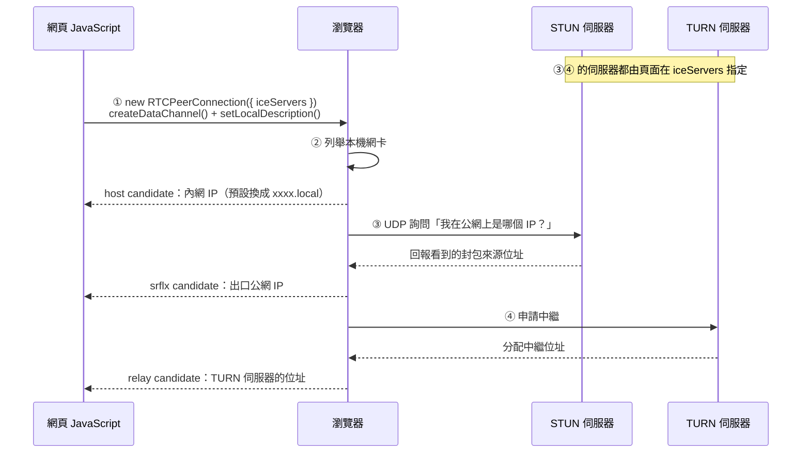

## WebRTC 是什麼

WebRTC (Web Real-Time Communication) 是[瀏覽器內建的即時通訊 API](https://developer.mozilla.org/en-US/docs/Web/API/WebRTC_API)，讓網頁不用外掛就能傳輸語音、視訊與任意資料。

## ICE 與三種 candidate

兩台裝置通常都躲在 NAT 或防火牆後面，WebRTC 用 ICE (Interactive Connectivity Establishment) 找出彼此可用的路徑。頁面建立連線物件時，在 `iceServers` 指定要用哪些 STUN / TURN 伺服器，瀏覽器再據此從三個來源收集位址，統稱 ICE candidate：



| 類型  | 怎麼來的                                        | 揭露了什麼                                                       |
| ----- | ----------------------------------------------- | ---------------------------------------------------------------- |
| host  | 列舉本機網卡位址                                | 內網 IP（例如 `192.168.x.x`）；IPv6 的 host 位址常常就是公網位址 |
| srflx | 向 STUN 伺服器詢問「我在公網上看起來是哪個 IP」 | 你連線出口的公網 IP                                              |
| relay | 向 TURN 伺服器申請中繼                          | 只有 TURN 伺服器的位址，不揭露你                                 |

沒有指定的伺服器就不會產生對應的 candidate：`iceServers` 留空時只有 host。但想取得 IP 的頁面一定會填一個公開 STUN 伺服器（例如 Google 的 `stun:stun.l.google.com:19302`），成本是零。只建立 `RTCPeerConnection` 還不會開始收集，頁面要再建一個通道（例如 `createDataChannel("")`）並呼叫 `setLocalDescription()`，瀏覽器才會列舉網卡、查詢 STUN。這幾行就是全部門檻，頁面上的 JavaScript 隨即能在 `onicecandidate` 事件裡讀到這些 candidate，過程沒有任何權限提示，這套機制本身是為了連線，但也帶來兩個副作用。

## 後果一：真實 IP 外洩

雖然現代瀏覽器[在網頁沒有取得攝影機或麥克風權限時，會把 host candidate 換成隨機的 xxxx.local mDNS 名稱](https://datatracker.ietf.org/doc/html/draft-ietf-rtcweb-mdns-ice-candidates)，預設已經讀不到內網 IP；但代表公網位址的 srflx 則不受此限，它直接反映了 STUN 查詢的 UDP 封包實際從哪個出口送出（封包走哪條路，srflx 就回報哪個 IP）。因此，真實公網 IP 會不會外洩，取決於你的 **網路代理（VPN）工具** 能不能接管瀏覽器發出的 UDP 流量：

| 連線方式                                           | WebRTC 回報的公網 IP                                     |
| -------------------------------------------------- | -------------------------------------------------------- |
| 系統級全隧道 VPN (WireGuard、OpenVPN 接管預設路由) | VPN 出口 IP，不外洩                                      |
| Clash 等工具的 TUN 模式                            | 代理出口 IP，不外洩（前提是規則讓 UDP 走代理）           |
| 瀏覽器代理設定、系統代理模式、擴充功能型「VPN」    | **真實 IP**：瀏覽器的代理機制只轉發 HTTP/TCP，就算代理是支援 UDP 的 SOCKS5，WebRTC 的 UDP 仍會繞過代理、直接從實體網卡出去 |
| VPN 開了分流 (split tunneling)                     | 看規則，瀏覽器被排除在外就會外洩                         |
| VPN 只走 IPv4，網路又有 IPv6                       | **真實 IPv6**                                            |

### 怎麼確認自己有沒有外洩

常遇到的「查 IP 網站顯示代理 IP，WebRTC 欄位卻是真實 IP」，幾乎都是表格第三列的情況，在開啟平常用的 VPN 或網路代理後，到下面網站查看，如果看得到你的真實 IP，那就是外洩了：

- [BrowserLeaks WebRTC](https://browserleaks.com/webrtc)
- [IPLeak.net](https://ipleak.net/)

## 後果二：被借用上傳頻寬

熱門直播尖峰時段的流量，全靠傳統 CDN 傳送的頻寬成本很高，於是有平台採用混合 **CDN + P2P (peer-assisted delivery)** 的架構：

- 播放器用 WebRTC DataChannel 在同時觀看的觀眾之間交換 HLS / DASH 的影片切片。
- 每個觀眾同時是下載者，也是上傳者。
- CDN 負責開播頭幾秒的冷啟動，以及附近沒有 peer 能及時供片段時補位。
- 觀眾越集中，能從 CDN 分攤掉的流量越多；省下的頻寬成本，某種程度上是轉嫁到觀眾的上傳頻寬。

對觀眾的影響：

- 上行頻寬被占用，用行動網路時會消耗流量額度。
- 你的公網 IP 會透過 candidate 揭露給同時在看的其他觀眾，而不只是平台伺服器。
- 這層 P2P 通常內嵌在播放器裡，多數平台沒有明顯的告知或開關。

## 如何限制 WebRTC

- 完全停用：拿不到任何 candidate，也建不了 P2P，但網頁視訊、語音、螢幕分享會跟著失效。
- 只擋外洩：保留 WebRTC 功能，只限制它能用哪些介面或要求 UDP 走代理。

Chromium 系瀏覽器的擴充功能與企業政策，底層都是在切換同一組 IP 處理模式：

| 模式                                    | 行為                                                     |
| --------------------------------------- | -------------------------------------------------------- |
| `default`                               | 使用所有介面（預設）                                     |
| `default_public_and_private_interfaces` | 只用預設路由的介面，公網與內網位址都可能提供             |
| `default_public_interface_only`         | 只用預設路由介面的公網位址，不提供內網位址               |
| `disable_non_proxied_udp`               | 不走代理的 UDP 一律停用；有代理時只能透過代理以 TCP 連線 |

對使用代理的人來說，真正擋住 srflx 外洩的是 `disable_non_proxied_udp`；前三種只決定用哪張網卡，封包仍不會進代理。

文擋：[Chrome Extensions API – privacy.network](https://developer.chrome.com/docs/extensions/reference/api/privacy#enum_1)

### Firefox

網址列輸入 `about:config`，接受風險提示後搜尋：

| 參數                                                  | 設定值  | 效果與使用建議                                                                                                                  |
| ----------------------------------------------------- | ------- | ------------------------------------------------------------------------------------------------------------------------------- |
| `media.peerconnection.enabled`                        | `false` | 完全停用 WebRTC。若不需要在瀏覽器中使用視訊會議，建議採用此設定，最為乾淨直接。                                                 |
| `media.peerconnection.ice.proxy_only_if_behind_proxy` | `true`  | 有設定代理時，WebRTC 只能透過代理連線（對應上表的 `disable_non_proxied_udp`）。若想保留 WebRTC 功能並使用代理，建議採用此設定。 |
| `media.peerconnection.ice.default_address_only`       | `true`  | 只使用預設路由介面。若使用全隧道 VPN，可作為額外的隱私防護。                                                                    |
| `media.peerconnection.ice.no_host`                    | `true`  | 不提供 host candidate。若使用全隧道 VPN，可與上一項搭配，作為額外的隱私防護。                                                   |

文檔：[Mozilla – WebRTC Privacy](https://wiki.mozilla.org/Media/WebRTC/Privacy)

### Chrome

Chrome 和 Edge 的設定頁裡都沒有停用 WebRTC 的開關，要調整得靠其他手段。

1. 擴充功能：

- [WebRTC Network Limiter](https://chromewebstore.google.com/detail/webrtc-network-limiter/npeicpdbkakmehahjeeohfdhnlpdklia)：WebRTC 專案官方發布，可選擇上面介紹的 IP 處理模式，只擋 IP 外洩，不影響 WebRTC 本身運作。
- [WebRTC Leak Prevent](https://chromewebstore.google.com/detail/webrtc-leak-prevent/eiadekoaikejlgdbkbdfeijglgfdalml)：原理相同，同樣透過瀏覽器的隱私 API 設定 IP 處理模式。
- [WebRTC Control](https://chromewebstore.google.com/detail/webrtc-control/fjkmabmdepjfammlpliljpnbhleegehm)：工具列一鍵切換，關閉時直接停用整個 WebRTC。

如果願意換瀏覽器，同為 Chromium 系的 [Brave](https://brave.com/) 在「設定 → 隱私權與安全性 → WebRTC IP 處理政策」直接內建上面四種模式的選單，不用裝擴充功能或改登錄機碼。


2. 企業政策（Chrome Enterprise policy）

一般版 Chrome 就內建，瀏覽器啟動時會讀取系統中的政策設定並套用，Windows 可透過群組原則或登錄機碼設定。

Chrome 提供 `WebRtcIPHandling` 政策，值直接填上面的模式名稱：

```text
WebRtcIPHandling = disable_non_proxied_udp
```

[133 版另外新增 `WebRtcIPHandlingUrl`，可以針對特定網站套用不同模式](https://chromeenterprise.google/policies/web-rtc-ip-handling-url/)，例如全域限制、只對視訊會議網站放行。設定後可到 `chrome://policy` 確認是否生效。設定選單底部會出現「你的瀏覽器由貴機構管理」，這是套用政策的正常提示。

網路上常見的啟動參數 `--force-webrtc-ip-handling-policy` 不要用：它是 Chromium 給測試環境用的開關，實測在 Chrome 156 正式版加上 `disable_non_proxied_udp` 後，頁面照樣拿得到 srflx 公網 IP；同樣的值寫進設定檔才會生效。不想裝擴充功能的話，用上面的企業政策最穩妥。

### 使用者腳本 (Tampermonkey / Violentmonkey)

想要跨瀏覽器、不依賴特定擴充功能的做法，可以用使用者腳本把 `RTCPeerConnection` 拿掉，讓頁面拿不到 candidate，也建不了 DataChannel，效果上等同完全停用。

不過使用者腳本是在頁面裡攔截 API，而不是從瀏覽器層級關掉，刻意繞過的頁面仍有機會拿回原本的建構子（例如透過 `window.frames[0]` 取得 iframe 的 window）。它適合無法修改瀏覽器設定，或想一支腳本套用到多個瀏覽器的情況；需要確實停用時，優先用 Firefox 的 `about:config` 或 Chrome 政策。

腳本中幾個關鍵設定：

- `@run-at document-start` 要趕在頁面腳本之前把 API 換掉，否則有些頁面一載入就先收集 candidate。
- `@grant none` 讓腳本跑在頁面 context，覆寫 `window` 才會對頁面生效；改用 `GM_*` 權限會進沙箱，覆寫可能無效。
- 建構子定義成 `undefined`，而不是換成會丟錯的假建構子：頁面用 `typeof RTCPeerConnection` 偵測時會判定為不支援，P2P 播放器就會退回純 CDN。假建構子的 `typeof` 仍是 `"function"`，會通過偵測，沒包 `try...catch` 的播放器一 `new` 就整個中斷。
- `configurable: false` 讓頁面之後無法把建構子，以及下面的 iframe 攔截改回原本的。
- 攔截 `contentWindow` 與 `contentDocument`：頁面可以建立同源的 iframe，透過 `iframe.contentWindow` 或 `iframe.contentDocument.defaultView` 拿回原始的 `RTCPeerConnection`，所以在交出 iframe 的 window 之前先鎖住。`window.frames[0]` 這類路徑不經過這個攔截，也就是仍可能被繞過的地方。
- 需要開會時，在腳本管理器面板暫停這支腳本，或把 `@match` 限縮到想保護的網站。

```js
// ==UserScript==
// @name         關閉 WebRTC（防 IP 外洩 / 防 P2P 上傳）
// @namespace    https://blog.minz.li/
// @version      1.0.0
// @description  停用 RTCPeerConnection，避免真實 IP 經由 ICE candidate 外洩，也阻止播放器借用上行頻寬做 P2P 分發
// @match        *://*/*
// @run-at       document-start
// @grant        none
// ==/UserScript==

(function () {
  "use strict";

  // 各家前綴的建構子
  var targets = [
    "RTCPeerConnection",
    "webkitRTCPeerConnection",
    "mozRTCPeerConnection",
  ];

  // 把指定 window 上的建構子定義成 undefined 並鎖住，不讓頁面改回來。
  // 頁面用 typeof 偵測會判定為不支援 WebRTC，P2P 播放器就會退回純 CDN；
  // 換成會丟錯的假建構子反而會通過偵測，沒做防呆的播放器可能整個中斷
  function block(win) {
    targets.forEach(function (name) {
      try {
        Object.defineProperty(win, name, {
          value: undefined,
          writable: false,
          configurable: false,
        });
      } catch (e) {
        // 已經鎖過、跨來源或不可覆寫，略過
      }
    });
  }

  block(window);

  // 頁面可以建立同源的 about:blank iframe，從裡面拿回原始建構子；
  // contentWindow 與 contentDocument.defaultView 都能取得 iframe 的 window，
  // 兩個入口都攔截，在交給頁面之前先鎖住
  function hookIframe(prop, toWindow) {
    var desc = Object.getOwnPropertyDescriptor(HTMLIFrameElement.prototype, prop);
    if (!desc || !desc.get) return;
    Object.defineProperty(HTMLIFrameElement.prototype, prop, {
      configurable: false,
      enumerable: desc.enumerable,
      get: function () {
        var value = desc.get.call(this);
        var win = value && toWindow(value);
        if (win) block(win);
        return value;
      },
    });
  }

  hookIframe("contentWindow", function (win) {
    return win;
  });
  hookIframe("contentDocument", function (doc) {
    return doc.defaultView;
  });
})();
```

### 副作用與注意事項

- 完全停用後，Google Meet、Discord 網頁版、線上客服的語音視訊與螢幕分享都會失效。
- 瀏覽器大版本更新偶爾會重置擴充功能或設定，更新後再跑一次檢測。
- 行動端較實際的做法是改用系統級全隧道 VPN，讓 UDP 也走隧道。
